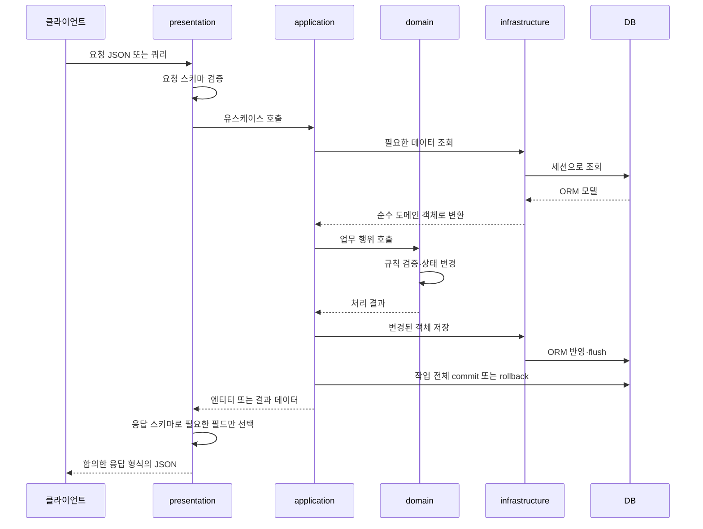

# 프로젝트 구조 안내

[README로 돌아가기](../README.md)

> 프로젝트 공통 구조와 사용 원칙을 안내합니다. 도메인 내부 설계와 구현 현황은 각 담당 도메인의 문서에서 관리합니다.

## 전체 구조

```text
AX_game_BE_api/
├── .github/
├── docs/
├── src/
│   ├── auth/
│   ├── users/
│   ├── inventory/
│   ├── auction/
│   ├── wallet/
│   ├── shared/
│   ├── templates/
│   ├── static/
│   ├── main.py
│   └── database.py
├── .gitignore
├── .python-version
├── pyproject.toml
├── uv.lock
└── README.md
```

## 도메인 바로가기

| 경로 | 역할 |
| --- | --- |
| [auth](../src/auth/) | 로그인·로그아웃·토큰 관리 |
| [users](../src/users/) | 회원 정보·상태 |
| [inventory](../src/inventory/) | 아이템·소유권·예약 |
| [wallet](../src/wallet/) | 지갑·잔액 |
| [auction](../src/auction/) | 경매장 매물·거래 |

## 요청 처리 흐름 — 학습 가이드

아래는 **구현할 때 따를 흐름**이며, 폴더 의존성 그림이나 현재 연결 완료 상태를 뜻하지 않습니다. 도메인이 저장소를 직접 호출하지 않고, 응용 서비스가 조회·업무 행위·저장을 조율합니다.



- 조회만 하는 요청은 상태 변경·저장 단계를 생략합니다.
- 신규 생성은 기존 객체 조회 대신 엔티티 생성·검증이 들어갈 수 있습니다.
- 예외가 요청 처리 경계로 전파되면 등록된 핸들러가 오류 응답으로 변환합니다. 현재 공통 핸들러는 업무 예외와 예상 밖 500 오류를 처리합니다.
- 요청 검증 오류·HTTP 예외까지 동일 형식으로 맞추는 작업과 공통 성공 응답 연결은 별도 확인이 필요합니다.
- 응답 스키마는 공개할 필드를 제한하고, 업무 규칙 판단은 도메인 객체가 맡습니다.

## 공통 파일과 설정

| 경로 | 용도·현재 상태 |
| --- | --- |
| [main.py](../src/main.py) | 앱·/health·lifespan·로깅·예외 처리 연결. 등록된 메타데이터로 테이블 생성, 종료 시 엔진 정리. 도메인 라우터 연결은 아직 없음 |
| [database.py](../src/database.py) | 비동기 엔진·세션·Base·get_db 및 예외 시 롤백. DATABASE_URL 환경변수 필요 |
| [exceptions.py](../src/shared/core/exceptions.py) | 공통 업무 예외 |
| [exception_handlers.py](../src/shared/core/exception_handlers.py) | 업무 오류 400·404·409와 예상 밖 500 응답 변환 |
| [logging_config.py](../src/shared/core/logging_config.py) | 공통 로깅 설정 |
| [공통 모듈 메모](../src/shared/core/README.md) | 공통 로깅·예외 처리의 역할과 사용 원칙 |
| [templates](../src/templates/) / [static](../src/static/) | HTML / CSS·이미지·JS 위치. 현재 .gitkeep만 존재 |
| [.github](../.github/) | [PR](../.github/pull_request_template.md), [작업](../.github/ISSUE_TEMPLATE/task.md), [버그](../.github/ISSUE_TEMPLATE/bug.md) 템플릿 |
| [pyproject.toml](../pyproject.toml) / [uv.lock](../uv.lock) | 프로젝트·의존성 설정 / 버전 잠금 |
| [.python-version](../.python-version) / [.gitignore](../.gitignore) | Python 버전 / Git 추적 제외 규칙 |

`__init__.py`는 패키지 표시, `.gitkeep`은 빈 폴더 공유용 파일입니다. ORM 모델은 테이블 생성 전에 Base 메타데이터에 등록되어야 합니다.

## 협업·의존성 원칙

- domain은 FastAPI·SQLAlchemy 등 외부 프레임워크를 참조하지 않습니다.
- application이 domain과 저장소를 사용해 작업을 조율하고, infrastructure는 계약을 구현합니다.
- 저장소는 전체 작업을 임의로 커밋하지 않습니다. 여러 도메인 변경은 동일 트랜잭션으로 조율합니다.
- 다른 도메인의 내부 데이터를 직접 변경하지 않고 합의한 기능으로 협업합니다.
- 공통 파일 변경은 담당자와 협의하고 계층 간 순환 참조를 피합니다.

실행 방법: [README의 개발 서버 실행](../README.md#개발-서버-실행).
