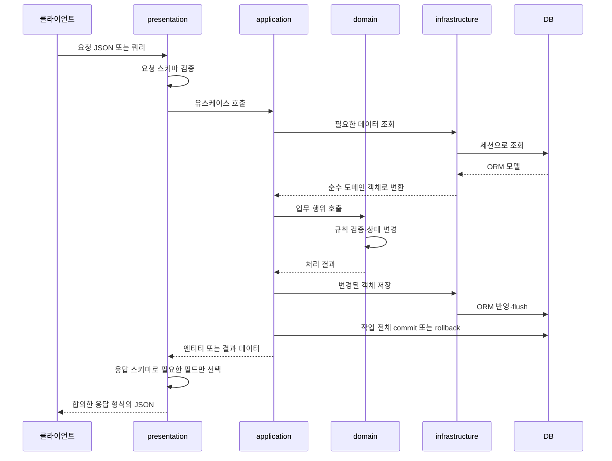

# 프로젝트 구조 안내

[README로 돌아가기](../README.md)

> 프로젝트 공통 구조와 사용 원칙을 안내합니다. 도메인 내부 설계와 구현 현황은 각 담당 도메인의 문서에서 관리합니다.

## 전체 구조

```text
AX_game_BE_api/
├── .github/
├── docs/
├── src/
│   ├── auth/
│   ├── users/
│   ├── inventory/
│   ├── auction/
│   ├── wallet/
│   ├── shared/
│   ├── templates/
│   ├── static/
│   ├── main.py
│   └── database.py
├── .gitignore
├── .python-version
├── pyproject.toml
├── uv.lock
└── README.md
```

## 도메인 바로가기

| 경로 | 역할 |
| --- | --- |
| [auth](../src/auth/) | 로그인·로그아웃·토큰 관리 |
| [users](../src/users/) | 회원 정보·상태 |
| [inventory](../src/inventory/) | 아이템·소유권·예약 |
| [wallet](../src/wallet/) | 지갑·잔액 |
| [auction](../src/auction/) | 경매장 매물·거래 |

## 요청 처리 흐름 — 학습 가이드

아래는 **구현할 때 따를 흐름**이며, 폴더 의존성 그림이나 현재 연결 완료 상태를 뜻하지 않습니다. 도메인이 저장소를 직접 호출하지 않고, 응용 서비스가 조회·업무 행위·저장을 조율합니다.



- 조회만 하는 요청은 상태 변경·저장 단계를 생략합니다.
- 신규 생성은 기존 객체 조회 대신 엔티티 생성·검증이 들어갈 수 있습니다.
- 예외가 요청 처리 경계로 전파되면 등록된 핸들러가 오류 응답으로 변환합니다. 현재 공통 핸들러는 업무 예외와 예상 밖 500 오류를 처리합니다.
- 요청 검증 오류·HTTP 예외까지 동일 형식으로 맞추는 작업과 공통 성공 응답 연결은 별도 확인이 필요합니다.
- 응답 스키마는 공개할 필드를 제한하고, 업무 규칙 판단은 도메인 객체가 맡습니다.

## 공통 파일과 설정

| 경로 | 용도·현재 상태 |
| --- | --- |
| [main.py](../src/main.py) | 앱·/health·lifespan·로깅·예외 처리 연결. 등록된 메타데이터로 테이블 생성, 종료 시 엔진 정리. 도메인 라우터 연결은 아직 없음 |
| [database.py](../src/database.py) | 비동기 엔진·세션·Base·get_db 및 예외 시 롤백. DATABASE_URL 환경변수 필요 |
| [exceptions.py](../src/shared/core/exceptions.py) | 공통 업무 예외 |
| [exception_handlers.py](../src/shared/core/exception_handlers.py) | 업무 오류 400·404·409와 예상 밖 500 응답 변환 |
| [logging_config.py](../src/shared/core/logging_config.py) | 공통 로깅 설정 |
| [공통 모듈 메모](../src/shared/core/README.md) | 공통 로깅·예외 처리의 역할과 사용 원칙 |
| [templates](../src/templates/) / [static](../src/static/) | Jinja2 화면, 공통 페이지 전환, CSS, 이미지와 페이지별 JavaScript. 아래 공통 웹 화면 절 참고 |
| [.github](../.github/) | [PR](../.github/pull_request_template.md), [작업](../.github/ISSUE_TEMPLATE/task.md), [버그](../.github/ISSUE_TEMPLATE/bug.md) 템플릿 |
| [pyproject.toml](../pyproject.toml) / [uv.lock](../uv.lock) | 프로젝트·의존성 설정 / 버전 잠금 |
| [.python-version](../.python-version) / [.gitignore](../.gitignore) | Python 버전 / Git 추적 제외 규칙 |

`__init__.py`는 패키지 표시, `.gitkeep`은 빈 폴더 공유용 파일입니다. ORM 모델은 테이블 생성 전에 Base 메타데이터에 등록되어야 합니다.

## 협업·의존성 원칙

- domain은 FastAPI·SQLAlchemy 등 외부 프레임워크를 참조하지 않습니다.
- application이 domain과 저장소를 사용해 작업을 조율하고, infrastructure는 계약을 구현합니다.
- 저장소는 전체 작업을 임의로 커밋하지 않습니다. 여러 도메인 변경은 동일 트랜잭션으로 조율합니다.
- 다른 도메인의 내부 데이터를 직접 변경하지 않고 합의한 기능으로 협업합니다.
- 공통 파일 변경은 담당자와 협의하고 계층 간 순환 참조를 피합니다.

실행 방법: [README의 개발 서버 실행](../README.md#개발-서버-실행).

## 공통 웹 화면

`templates/base.html`은 배경, 헤더, 본문과 푸터를 구성합니다. `static/app.js`는 최초 로드에 한 번 실행됩니다. 내부 링크와 GET 검색 폼은 서버 HTML을 받아 `#main-content`의 내용만 바꿉니다. 관리자 화면 내부에서는 `#admin-view`를 교체해 관리자 탭도 유지합니다.

헤더 요소 자체는 유지하며 `data-shell-slot`으로 지정한 로고 링크, 메뉴, 사용자 표시 중 바뀐 부분을 갱신합니다. 로그인 상태와 권한의 판단은 기존 서버 라우터가 담당합니다. 이전 페이지의 HTML을 캐시하거나 인증 정보를 JavaScript에 저장하지 않습니다.

### 담당별 수정 위치

| 변경 대상 | 파일 |
| --- | --- |
| 공통 배경, 헤더, 푸터 | `templates/base.html`, `static/css/global.css` |
| 화면 내용 | `templates/<도메인>/`의 해당 템플릿 |
| 페이지별 동작 등록 | `static/pages.js` |
| 링크, 폼, 뒤로 가기 처리 | `static/navigation/page-navigation.js` |
| 본문, 헤더 표시와 페이지 CSS 교체 | `static/navigation/page-renderer.js` |
| 세션 확인, 자동 갱신, 만료 처리 | `static/auth-session.js` |
| 관리자 기능 조립 | `static/admin.js` |
| 카탈로그 목록, 편집, 이미지, 이력 | `static/admin/`의 해당 파일 |
| 회원 관리 폼 | `static/admin-members.js` |

### 새 페이지 연결

HTML만 표시하는 페이지는 `base.html`을 상속하고 `content` 블록을 작성하면 됩니다. 일반 링크와 GET 폼에 별도 클릭 이벤트를 붙일 필요가 없습니다. 페이지 전용 CSS에는 `data-page-style`을 붙입니다. 새 CSS의 로드가 끝나면 적용하고 이전 페이지 전용 CSS를 제거합니다.

```html

wallet


<link data-page-style rel="stylesheet" href="{{ url_for('static', path='/css/wallet.css') }}">



<section id="wallet-page">...</section>

```

위 `wallet`은 연결 형식을 보여 주는 예입니다. 현재 지갑 화면 구현을 뜻하지 않습니다. 페이지에 동작이 필요하면 초기화 함수를 작성하고 `pages.js`의 `pageInitializers`에 `page_key`와 함께 등록합니다. 페이지 HTML에 추가한 스크립트는 부분 전환 시 다시 실행하지 않으므로 동작은 초기화 함수에서 연결합니다.

```javascript
export function initWalletPage({ root, signal, navigate }) {
    const button = root.querySelector("#open-inventory");

    function onOpenInventory() {
        void navigate("/inventory");
    }

    button.addEventListener("click", onOpenInventory, { signal });
}
```

`root`는 현재 본문입니다. `signal`은 다음 화면이 적용될 때 취소됩니다. 조회 요청과 이벤트에 이 signal을 전달하고 별도 타이머가 있으면 abort 이벤트에서 해제합니다. `navigate(path, { replace: true })`는 현재 방문 기록을 대체하며, 일반 `navigate(path)`는 새 주소를 방문 기록에 추가합니다. 페이지별 초기화 함수를 서로 직접 호출하지 않습니다.

인증 화면은 기존 `auth/base.html`과 `page` 블록을 사용합니다. 다른 보호 화면은 `body_attributes`에 `data-session-protected="true"`를 지정하면 세션 확인이 연결됩니다. 이 속성은 브라우저의 자동 갱신용이며 서버의 인증 의존성을 대신하지 않습니다.

### 폼, 오류와 예외 이동

- HTML 응답을 반환하는 POST 폼은 `data-page-form`을 붙여 부분 전환에 참여시킵니다. 현재 로그인, 회원가입, 로그아웃 폼에 적용했습니다. 서버의 Origin 검사와 HttpOnly 쿠키를 그대로 사용합니다.
- JSON API를 사용하는 관리자 폼은 해당 기능 모듈에서 처리합니다. 개별 이벤트가 `preventDefault()`를 호출하면 공통 폼 처리는 개입하지 않습니다.
- 진행 중인 공통 POST 폼은 중복 제출하지 않습니다. 서버/통신 실패 시 자동 재전송하지 않고 결과 확인 안내를 표시합니다. 서버가 HTML 오류 화면을 반환하면 해당 화면을 표시합니다.
- 다운로드 링크는 `download`, 일반 문서 이동이 필요한 링크/폼은 `data-full-reload`를 지정합니다. 외부 링크, 새 탭, 수정 키 클릭과 같은 페이지의 앵커는 브라우저 기본 동작을 유지합니다.
- 실패한 GET 이동은 현재 화면과 URL을 유지합니다. 뒤로 가기 요청이 실패하면 해당 URL을 일반 문서로 다시 읽습니다. 빠른 연속 이동에서는 이전 조회를 취소합니다.
- JavaScript가 없을 때도 기존 서버 HTML 링크와 폼을 사용할 수 있습니다. 브라우저 내 입력 상태와 스크롤 위치를 방문 기록마다 저장하는 기능은 제공하지 않습니다.

### 검증 범위

2026-11-10, 격리된 서버의 실제 템플릿과 인증 HTTP 라우터에서 Chromium 검증을 수행했습니다. 인증 서비스와 화면 데이터는 테스트 대역을 사용했으며 사용자 DB와 운영 서버는 변경하지 않았습니다.

로그인/회원가입/로그아웃, 실패 응답, 중복 POST 방지, 세션 만료, 인벤토리 목록/상세/도감/필터/404, 관리자 진입과 복귀, 저장/검색, 뒤로/앞으로 가기, 연속 이동과 늦은 응답, CSS 실패 후 복구를 확인했습니다. 부분 이동 중 배경, 헤더와 본문 컨테이너의 DOM 동일성과 추가 문서 로드 없음, 390px 모바일 화면, JavaScript 오류 없음을 확인했습니다. 세션 타이머의 기존 10개 시나리오도 통과했습니다. DB 거래와 실제 배포 검증은 포함하지 않았습니다.

격리된 검증 서버의 관리자 화면과 세션 만료 후 로그인 화면입니다. 화면의 계정과 아이템은 검증용 데이터입니다. 배경과 헤더 유지 여부는 위 브라우저 검사에서 DOM 동일성과 document 요청 수로 확인했습니다.


