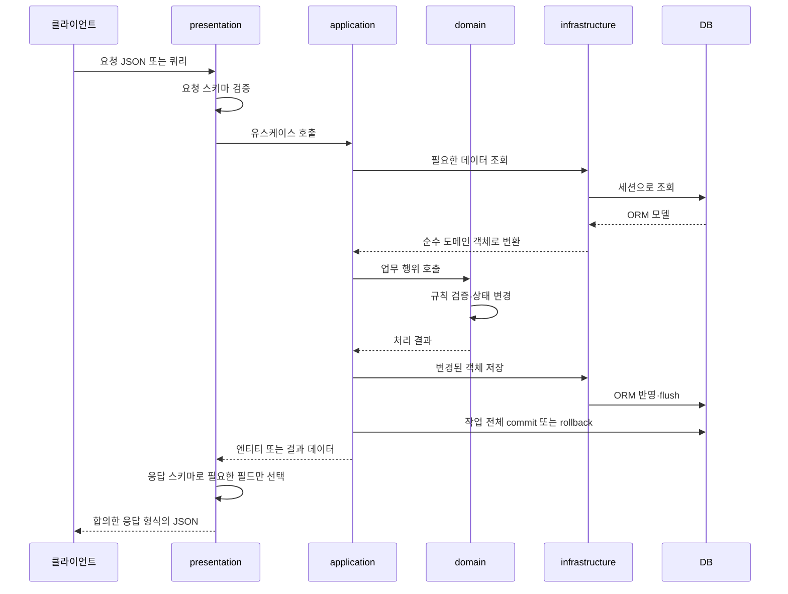
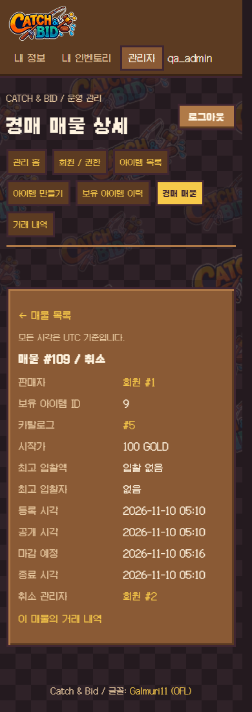
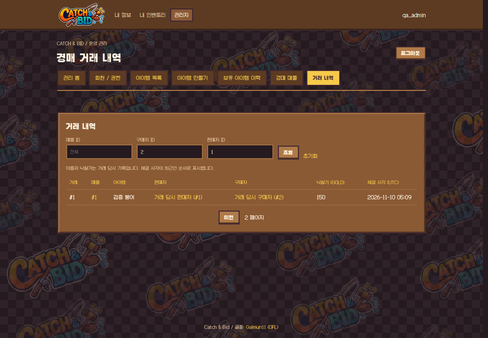
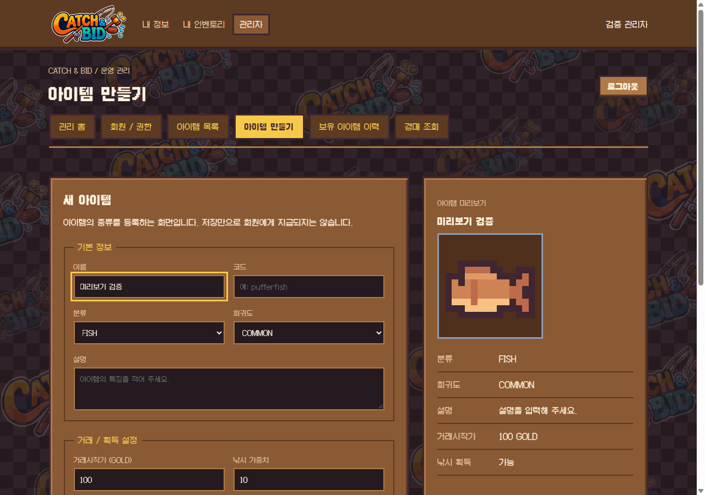
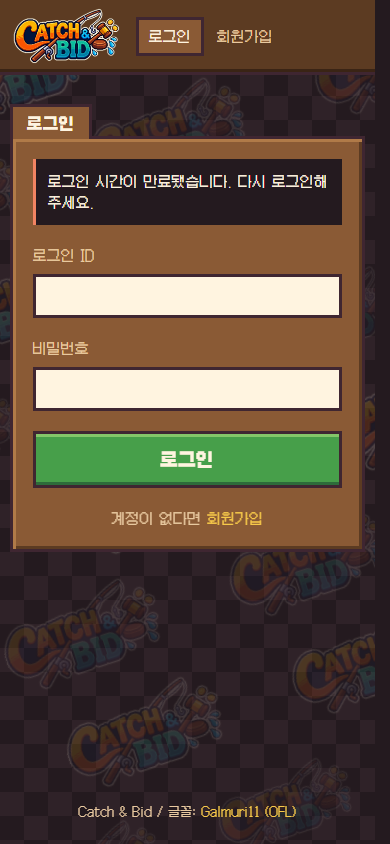

# 프로젝트 구조 안내

[README로 돌아가기](../README.md)

> 프로젝트 공통 구조와 사용 원칙을 안내합니다. 도메인 내부 설계와 구현 현황은 각 담당 도메인의 문서에서 관리합니다.

## 전체 구조

```text
AX_game_BE_api/
├── .github/
├── docs/
├── src/
│   ├── auth/
│   ├── users/
│   ├── inventory/
│   ├── auction/
│   ├── wallet/
│   ├── shared/
│   ├── templates/
│   ├── static/
│   ├── composition.py
│   ├── web_router.py
│   ├── main.py
│   └── database.py
├── .gitignore
├── .python-version
├── pyproject.toml
├── uv.lock
└── README.md
```

## 도메인 바로가기

| 경로 | 역할 |
| --- | --- |
| [auth](../src/auth/README.md) | 로그인, 로그아웃과 토큰 관리. 담당 [@Cocode96](https://github.com/Cocode96) |
| [users](../src/users/README.md) | 회원 정보와 상태. 담당 [@Cocode96](https://github.com/Cocode96) |
| [inventory](../src/inventory/README.md) | 아이템 카탈로그·소유권·소유 이력, 경매의 예약·해제·이전 제공, 낚시. 담당 [@eeseuju](https://github.com/eeseuju) |
| [wallet](../src/wallet/) | 지갑·잔액 |
| [auction](../src/auction/) | 경매장 매물·거래 |

## 요청 처리 흐름 — 학습 가이드

아래는 **구현할 때 따를 흐름**이며, 폴더 의존성 그림이나 현재 연결 완료 상태를 뜻하지 않습니다. 도메인이 저장소를 직접 호출하지 않고, 응용 서비스가 조회·업무 행위·저장을 조율합니다.



- 조회만 하는 요청은 상태 변경·저장 단계를 생략합니다.
- 신규 생성은 기존 객체 조회 대신 엔티티 생성·검증이 들어갈 수 있습니다.
- 예외가 요청 처리 경계로 전파되면 등록된 핸들러가 오류 응답으로 변환합니다. 현재 공통 핸들러는 업무 예외와 예상 밖 500 오류를 처리합니다.
- 요청 검증 오류·HTTP 예외까지 동일 형식으로 맞추는 작업과 공통 성공 응답 연결은 별도 확인이 필요합니다.
- 응답 스키마는 공개할 필드를 제한하고, 업무 규칙 판단은 도메인 객체가 맡습니다.

## 공통 파일과 설정

| 경로 | 용도·현재 상태 |
| --- | --- |
| [main.py](../src/main.py) | 앱, /health, lifespan, 로깅과 예외 처리, 도메인 라우터 등록. 시작 시 테이블과 회원 제어 컬럼 준비와 경매 마감 스케줄러 시작, 종료 시 스케줄러 중지와 엔진 정리. import·모델 등록·라우터 등록은 도메인별 `# region`으로 구분하고, 낚시 라우터는 `DEMO_FISHING_ENABLED`(기본 켜짐)일 때만 등록 |
| [database.py](../src/database.py) | 비동기 엔진·세션·Base·get_db 및 예외 시 롤백. DATABASE_URL 환경변수 필요 |
| [exceptions.py](../src/shared/core/exceptions.py) | 공통 업무 예외 |
| [exception_handlers.py](../src/shared/core/exception_handlers.py) | 업무 오류 400·404·409와 예상 밖 500 응답 변환 |
| [logging_config.py](../src/shared/core/logging_config.py) | 공통 로깅 설정 |
| [공통 모듈 메모](../src/shared/core/README.md) | 공통 로깅·예외 처리의 역할과 사용 원칙 |
| [templates](../src/templates/) / [static](../src/static/) | Jinja2 화면, 공통 페이지 전환, CSS, 이미지와 페이지별 JavaScript. 아래 공통 웹 화면 절 참고 |
| [.github](../.github/) | [PR](../.github/pull_request_template.md), [작업](../.github/ISSUE_TEMPLATE/task.md), [버그](../.github/ISSUE_TEMPLATE/bug.md) 템플릿 |
| [pyproject.toml](../pyproject.toml) / [uv.lock](../uv.lock) | 프로젝트·의존성 설정 / 버전 잠금 |
| [.python-version](../.python-version) / [.gitignore](../.gitignore) | Python 버전 / Git 추적 제외 규칙 |

`__init__.py`는 패키지 표시, `.gitkeep`은 빈 폴더 공유용 파일입니다. ORM 모델은 테이블 생성 전에 Base 메타데이터에 등록되어야 합니다.

## 협업·의존성 원칙

- domain은 FastAPI·SQLAlchemy 등 외부 프레임워크를 참조하지 않습니다.
- application이 domain과 저장소를 사용해 작업을 조율하고, infrastructure는 계약을 구현합니다.
- 저장소는 전체 작업을 임의로 커밋하지 않습니다. 여러 도메인 변경은 동일 트랜잭션으로 조율합니다.
- 다른 도메인의 내부 데이터를 직접 변경하지 않고 합의한 기능으로 협업합니다.
- 도메인 사이의 호출은 **소비하는 쪽이 계약(Protocol)을 정하고**, 제공하는 쪽의 application 기능에 연결하는 어댑터가 구현합니다. 예: 경매의 `InventoryGateway`(예약·해제·이전·조회)를 `auction/infrastructure/adapters/inventory_gateway.py`가 인벤토리의 서비스에 연결합니다.
- 다른 도메인의 `infrastructure`는 import하지 않습니다. 어댑터는 상대 도메인의 application·domain·`wiring`만 사용하고, ORM 모델 등록과 스키마 보강은 `main.py`만 합니다.
- 여러 행을 잠글 때는 합의한 순서를 따릅니다: 매물 → 아이템 종류 → 다음 대기 매물 → 아이템 → 사용자 → 지갑. 여러 사용자는 ID 오름차순으로 잠급니다. commit·rollback은 호출하는 쪽(트랜잭션 담당)이 합니다.
- 화면 라우터는 현재 사용자 확인 함수를 `main.py`에서 넘겨 받습니다(`create_..._web_router(get_current_web_user_id, ...)`). 라우터가 다른 도메인의 인증 구조나 지갑 코드를 직접 알지 않게 하기 위해서입니다.
- 공통 파일 변경은 담당자와 협의하고 계층 간 순환 참조를 피합니다.

실행 방법: [README의 실행 방법](../README.md#실행-방법).

## 관리자 화면과 도메인 연결

**관리자 화면/연동과 조립 구조 정리: [@Cocode96](https://github.com/Cocode96)**

이 절은 여러 도메인에 걸친 관리자 기능의 연결을 설명합니다. 인증 자체의 계약은 [Auth README](../src/auth/README.md), 회원 관리의 규칙과 API는 [Users README](../src/users/README.md)를 참고하세요.

| 커밋된 작업 | 기여자 | 대표 커밋 |
| --- | --- | --- |
| 관리자 아이템 제작/이미지/회원 보유 아이템 화면 연결 | [@Cocode96](https://github.com/Cocode96) | `6f965b9`, `138822a`, `4702a7d` |
| 관리자 전체 매물 필터와 거래 내역 연결 | [@Cocode96](https://github.com/Cocode96) | `aef8bc8` |
| 관리자 기능의 도메인별 이동과 Auth 순환 참조 제거 | [@Cocode96](https://github.com/Cocode96) | `877ba38` |
| PR #35 취소 API의 웹 연결과 회귀 검증 | [@Cocode96](https://github.com/Cocode96) | `76ca092`, `bf39e47` |

대표 커밋은 이 문서가 포함된 브랜치의 실제 작성 이력을 기준으로 확인했습니다. 기여 표는 관리자 화면과 연동 작업을 기록합니다. 경매의 취소 업무 로직과 [PR #35](https://github.com/bsis09872-ux/AX_game_BE_api/pull/35)의 쿠키 인증 API는 Auction 담당자의 구현을 사용합니다.

관리자 기능은 기존 업무 도메인이 소유하며 별도의 Admin 도메인은 만들지 않습니다. 같은 FastAPI 앱에서 아래 라우터를 등록하므로 서버나 브라우저 주소가 분리되지 않습니다.

| 책임 | 코드 위치 |
| --- | --- |
| 쿠키 인증, 관리자 권한, 변경 요청의 Origin 검사 | `auth/presentation/web_dependencies.py` |
| 회원 생성, 역할, 로그인 정지와 입찰 제한 | `users/presentation/admin_router.py`, `users/application/admin_service.py` |
| 카탈로그, 이미지와 보유 아이템 관리 | `inventory/presentation/admin_router.py` |
| 전체 매물, 상세와 거래 내역 HTML | `auction/presentation/admin_router.py` |
| 쿠키 인증 강제 취소 API | `auction/presentation/listings/admin_web_router.py` |
| 인증 부품과 회원 관리 서비스 연결 | 앱 조립부 `composition.py` |
| 관리 홈과 공통 템플릿 | `web_router.py`, `templates/admin/` |

`main.py`가 각 관리자 라우터에 인증 의존성을 주입합니다. `composition.py`는 Auth가 제공한 비밀번호 해시와 세션 폐기 부품을 Users의 팩터리에 넘깁니다. 같은 DB 세션을 공유하므로 회원 정지와 로그인 세션 폐기는 함께 확정됩니다. Users는 Auth를 import하지 않습니다. 회원 생성 시 별도 지갑 생성은 호출하지 않으며 Wallet의 기존 지연 생성 정책을 유지합니다. 사용되지 않던 `MemberWalletProvisioner` 계약과 완료된 연동 TODO는 제거했습니다.

경매 화면용 `AdminAuctionQueries`는 Auction 내부에서 `ListingService`와 `TradeService`의 조회 결과를 DTO로 바꿉니다. 기존 Auth의 조회 Protocol/어댑터를 같은 도메인 안에서 중복 유지하지 않습니다. 조회 조립은 `auction/wiring.py`가 담당하고, 웹 인증과 경매 서비스가 현재 관리자 권한을 검사합니다.

Auth가 Auction을 조립하던 연결을 제거해 `Auth → Auction → Inventory → Auth` 순환 참조를 해소했습니다. 현재 도메인 간 참조는 Auction에서 Inventory/Wallet/Users로, Inventory에서 Auth/Users로, Auth와 Wallet에서 Users로 향합니다. 함수 내부 import로 참조를 숨기지 않습니다.

### 관리자 경매 조회

| 경로 | 검색 조건 |
| --- | --- |
| `/admin/auctions` | `listing_id`, `item_definition_id`, `inventory_item_id`, `status`, `page` |
| `/admin/auctions/{listing_id}` | 매물 상세. 목록의 검색 조건과 페이지를 쿼리로 보존해 복귀 |
| `/admin/auction-trades` | `listing_id`, `buyer_id`, `seller_id`, `page` |

비워 둔 조건은 전체 조회이며 지정한 조건은 AND로 적용합니다. 상태는 `QUEUED`, `BIDDING`, `SOLD`, `FAILED`, `CANCELLED`를 지원합니다. 페이지는 1부터 시작하고 경매 서비스 기준 한 번에 20건입니다. 매물은 등록 시각, 거래는 체결 시각의 내림차순이며 같은 시각이면 ID 내림차순입니다. 금액은 GOLD, 시각은 UTC로 표시합니다. 거래의 이름과 낙찰가는 현재 정보가 아닌 체결 당시 스냅샷입니다.

기존 `/admin/auctions?listing_id=...`는 해당 매물로 필터한 목록을 표시하며 상세 주소는 위 경로로 분리했습니다. 없는 상세는 HTML 404, 잘못된 조건은 422입니다. 로그인하지 않으면 로그인 화면으로 이동하고 일반 회원은 403을 받습니다. 조회 응답은 `no-store`이며 상태 변경이나 commit을 수행하지 않습니다. 마감 스케줄러는 선행 PR #35에서 앱 lifespan에 연결되어 서버 시작/종료와 함께 동작합니다. 관리자 조회 요청은 스케줄러를 별도로 실행하지 않습니다.

템플릿은 `templates/admin/layout.html`을 상속합니다. 검색, 탭과 상세 링크는 아래 공통 페이지 전환을 사용하므로 별도 JavaScript 이벤트를 추가하지 않습니다. 검색 입력과 페이지 링크는 `auction_macros.html`, 조건 검증과 URL 생성은 `auction/presentation/admin_queries.py`에서 공유합니다.

### 관리자 강제 취소

대기/진행 매물 상세에서 확인 창을 거쳐 취소합니다. PR #35의 `POST /admin/listings/{listing_id}/cancel`을 사용하며 요청 본문은 없습니다. HttpOnly 쿠키 인증, 현재 관리자 권한과 Origin을 검사하고 관리자 ID와 처리 시각은 서버에서 정합니다. 잘못된 ID는 422, 일반 회원과 허용하지 않은 Origin은 403, 없는 매물은 404, 이미 종료된 매물은 409입니다.

Auction의 웹 라우터가 `ListingService.admin_cancel(admin_id, listing_id, now)`에 위임합니다. Auction이 취소 기록, Inventory 예약 해제, 다음 대기 매물 공개와 commit을 담당하며 예외 시 요청의 `get_db`가 rollback합니다. 별도의 환불은 하지 않고 취소된 입찰 예약 금액만 제외됩니다. Auth에 별도 취소 계약/어댑터/요청 모델을 두지 않으며, 웹 취소 경로는 `/admin/listings/{listing_id}/cancel`로 통일합니다. Bearer 인증 `/v1/listings/management/{listing_id}/cancel`도 같은 서비스를 사용하며 요청 본문은 없습니다.

성공 후 공통 page-renderer로 상세를 다시 조회합니다. 처리 중 중복 제출을 막고 통신 실패 시 자동 재전송하지 않습니다. 응답만 유실됐을 수 있으므로 상세를 다시 조회해 상태를 확인합니다. 상세에서 취소 관리자와 종료 시각(`closed_at`, UTC)을 확인할 수 있습니다. 취소 사유는 입력하거나 저장하지 않습니다. 일반 경매 API 응답에는 관리자 ID를 추가하지 않습니다. Inventory 이력의 처리자는 V1 계약에 따라 판매자이며, 실제 취소 관리자는 Auction 기록으로 확인합니다.

기존 DB에는 서버를 새 버전으로 시작하기 전에 다음 명령을 한 번 실행합니다. 신규 DB는 모델에서 컬럼이 생성됩니다.

```powershell
uv run --frozen python scripts/migrate-auction-admin-cancel.py
```

이 명령은 현재 `DATABASE_URL` 대상의 `listings`에 `admin_cancelled_by BIGINT NULL`만 추가합니다. 이전 버전의 `admin_cancel_reason` 컬럼과 기록이 있으면 그대로 보존하며 신규 DB에는 만들지 않습니다. 기존 행과 취소 기록을 유지하고 재실행을 허용합니다. 이미 있는 컬럼의 타입이 다르거나 테이블 잠금을 5초 내 얻지 못하면 실패하며 해당 실행의 변경은 rollback됩니다. 서버 시작 시 자동 실행하지 않습니다.

### 관리자 조회와 취소 검증

구조 검증은 함수 내부 import를 포함한 도메인 간 순환 참조, domain/application의 프레임워크 의존, 초기 import 순서와 관리자 라우트 소유권/중복을 검사합니다. 통합 검증에는 `verify_admin_domains.py`의 기존 페이지 권한, 카탈로그 CRUD/필터/CSV, 회원 생성/권한/입찰 제한, 로그인 정지와 세션 폐기, 도메인 간 관리자 탭 이동도 포함합니다.

```powershell
uv run --frozen python scripts/verify-domain-boundaries.py
uv run --frozen --with httpx --with playwright python scripts/verify-admin-auctions.py
```

Chromium이 없으면 먼저 `uv run --with playwright playwright install chromium`을 실행합니다. `.env.local` 또는 환경변수의 `DATABASE_URL` 계정에 DB 생성 권한이 필요합니다. 검증은 무작위 이름의 임시 PostgreSQL DB, 별도 서버와 테스트 계정을 만들고 종료 시 제거합니다. 기존 DB의 데이터는 변경하지 않으며 결과 이미지와 로그는 Git에서 제외된 `.private/admin-auction-qa/`에 저장합니다.

2026-11-10 실행에서 전체 상태, 복합 필터, 페이지 경계와 조건 유지, 상세 404, 입력 검증, 큰 정수 ID, 스냅샷 HTML 이스케이프, 로그인/관리자 권한과 강등 후 차단을 확인했습니다. 실제 Chromium에서 뒤로/앞으로 가기, 본문 전환 시 공통 DOM 유지, 추가 문서 요청과 JavaScript 오류 없음, 390px 모바일 표 스크롤, JavaScript 없는 폼 제출을 검증했습니다. 조회 전후 매물, 거래, 인벤토리와 지갑 데이터가 동일했습니다. 선행 PR #35의 스케줄러 시작/종료 연결을 유지한 상태에서 검증했습니다. 만료 매물의 자동 정산 전체와 운영 배포는 이번 관리자 회귀 검증 범위에 포함하지 않습니다.

취소 검증은 `scripts/verify_admin_cancel.py`를 함께 실행합니다. 실제 쿠키/Bearer 인증, Origin, 입력과 상태 오류, 취소 기록, 재고 반환, FIFO 공개, 잔액 유지와 예약 금액 해제, 동시 취소의 단일 처리, 다음 매물 저장 실패 시 전체 rollback을 확인했습니다. 브라우저에서는 확인 창 닫기/승인, 중복 제출 방지, 완료 기록, 오래된 화면의 409와 성공 응답 유실 후 재조회 복구를 검증했습니다. 기존 구조의 임시 테이블에 컬럼 추가와 재실행, 데이터 보존도 확인했습니다. 강제 취소 조작에는 JavaScript가 필요합니다.





## 인벤토리·경매 화면

**인벤토리 화면과 경매 화면: [@eeseuju](https://github.com/eeseuju)**

일반 사용자 화면입니다. 화면 라우터는 서비스 호출과 화면 데이터 준비만 하고 업무 판정은 서비스·도메인이 합니다. 개인 화면이라 `Cache-Control: no-store`로 응답합니다.

| 화면 | 경로 | 코드 위치 |
| --- | --- | --- |
| 내 가방 | `/inventory` | `inventory/presentation/web_router.py` |
| 아이템 상세 | `/inventory/{item_id}` | 같은 파일 |
| 도감 | `/item-catalogs` | 같은 파일 |
| 경매장 목록(검색·페이지) | `/auctions` | `auction/presentation/web_router.py` |
| 경매 상세 | `/auctions/{listing_id}` | 같은 파일 |
| 경매 등록 | `/auctions/new` (GET 화면, POST 등록) | 같은 파일 |
| 입찰·취소 | `POST /auctions/{listing_id}/bid`, `/cancel` | 같은 파일 |
| 내 거래(낙찰·판매) | `/auctions/trades` | 같은 파일 |
| 상태 확인(화면 갱신용 JSON) | `GET /auctions/{listing_id}/state` | 같은 파일 |

**연결**
- `main.py`가 `get_current_web_user_id`(쿠키 인증)를 두 화면 라우터에 넘깁니다. 경매의 POST 화면은 `require_web_origin`(출처 검사)도 받습니다.
- 가방의 지갑 박스(잔액·묶인 골드·사용 가능 골드)는 지갑 쪽 읽기 함수 `read_wallet_box`를 `main.py`가 넘겨서 채웁니다. 인벤토리는 wallet을 import하지 않습니다. 헤더의 사용 가능 금액은 공통 헤더의 `static/wallet-balance.js`가 채웁니다.
- 게임 클라이언트의 팝업(iframe)에서는 `?embed=1`을 붙입니다. 헤더를 숨기고 보유 골드를 읽지 않으며, `static/auction-embed.js`가 닫기를 `auction:close` 메시지로 바깥 화면에 알립니다.

**화면 갱신**
- 경매 상세의 남은 시간과 진행 바는 서버가 준 남은 초를 기준으로 브라우저가 1초마다 직접 계산합니다.
- 입찰·가격·최고 입찰자·결과 같은 서버 상태는 `/auctions/{listing_id}/state`를 2초마다 확인하고, 마감 후 정산을 기다리는 동안은 1초마다 확인합니다. 바뀌었을 때만 화면을 다시 불러오며, 탭이 숨겨지면 확인을 멈추고 화면을 떠나면 `signal`로 정리합니다.
- 경매 목록은 카드의 남은 시간을 직접 세고 2초마다 목록을 다시 읽어 바뀐 카드만 갈아 끼웁니다.
- 낙찰·유찰 정산은 서버의 마감 스케줄러가 합니다(5초 주기). 그래서 마감 뒤 결과가 화면에 보이기까지 수 초가 걸릴 수 있습니다.
- 동작은 `static/auction-live.js`에 있고 `pages.js`에 `auction`·`inventory` 키로 등록되어 있습니다.

**API**: 인벤토리 조회·이력·카탈로그 API와 낚시 API(`POST /v1/fishing-results`)는 [inventory README](../src/inventory/README.md)를 참고하세요. 낚시는 `DEMO_FISHING_ENABLED`가 켜져 있을 때만 등록되며 기본은 켜짐입니다.

## 공통 웹 화면

`templates/base.html`은 배경, 헤더, 본문과 푸터를 구성합니다. `static/app.js`는 최초 로드에 한 번 실행됩니다. 내부 링크와 GET 검색 폼은 서버 HTML을 받아 `#main-content`의 내용만 바꿉니다. 관리자 화면 내부에서는 `#admin-view`를 교체해 관리자 탭도 유지합니다.

헤더 요소 자체는 유지하며 `data-shell-slot`으로 지정한 로고 링크, 메뉴, 사용자 표시 중 바뀐 부분을 갱신합니다. 로그인 상태와 권한의 판단은 기존 서버 라우터가 담당합니다. 이전 페이지의 HTML을 캐시하거나 인증 정보를 JavaScript에 저장하지 않습니다.

### 담당별 수정 위치

| 변경 대상 | 파일 |
| --- | --- |
| 공통 배경, 헤더, 푸터 | `templates/base.html`, `static/css/global.css` |
| 화면 내용 | `templates/<도메인>/`의 해당 템플릿 |
| 페이지별 동작 등록 | `static/pages.js` |
| 링크, 폼, 뒤로 가기 처리 | `static/navigation/page-navigation.js` |
| 본문, 헤더 표시와 페이지 CSS 교체 | `static/navigation/page-renderer.js` |
| 세션 확인, 자동 갱신, 만료 처리 | `static/auth-session.js` |
| 관리자 기능 조립 | `static/admin.js` |
| 카탈로그 목록, 편집, 이미지, 이력 | `static/admin/`의 해당 파일 |
| 회원 관리 폼 | `static/admin-members.js` |
| 경매·가방 화면의 시간 계산과 상태 확인 | `static/auction-live.js` |
| 헤더의 사용 가능 금액 | `static/wallet-balance.js` |
| 경매 팝업(iframe) 닫기 알림 | `static/auction-embed.js` |

### 새 페이지 연결

HTML만 표시하는 페이지는 `base.html`을 상속하고 `content` 블록을 작성하면 됩니다. 일반 링크와 GET 폼에 별도 클릭 이벤트를 붙일 필요가 없습니다. 페이지 전용 CSS에는 `data-page-style`을 붙입니다. 새 CSS의 로드가 끝나면 적용하고 이전 페이지 전용 CSS를 제거합니다.

```html

wallet


<link data-page-style rel="stylesheet" href="{{ url_for('static', path='/css/wallet.css') }}">



<section id="wallet-page">...</section>

```

위 `wallet`은 연결 형식을 보여 주는 예입니다. 현재 지갑 화면 구현을 뜻하지 않습니다. 페이지에 동작이 필요하면 초기화 함수를 작성하고 `pages.js`의 `pageInitializers`에 `page_key`와 함께 등록합니다. 페이지 HTML에 추가한 스크립트는 부분 전환 시 다시 실행하지 않으므로 동작은 초기화 함수에서 연결합니다.

```javascript
export function initWalletPage({ root, signal, navigate }) {
    const button = root.querySelector("#open-inventory");

    function onOpenInventory() {
        void navigate("/inventory");
    }

    button.addEventListener("click", onOpenInventory, { signal });
}
```

`root`는 현재 본문입니다. `signal`은 다음 화면이 적용될 때 취소됩니다. 조회 요청과 이벤트에 이 signal을 전달하고 별도 타이머가 있으면 abort 이벤트에서 해제합니다. `navigate(path, { replace: true })`는 현재 방문 기록을 대체하며, 일반 `navigate(path)`는 새 주소를 방문 기록에 추가합니다. 페이지별 초기화 함수를 서로 직접 호출하지 않습니다.

인증 화면은 기존 `auth/base.html`과 `page` 블록을 사용합니다. 다른 보호 화면은 `body_attributes`에 `data-session-protected="true"`를 지정하면 세션 확인이 연결됩니다. 이 속성은 브라우저의 자동 갱신용이며 서버의 인증 의존성을 대신하지 않습니다.

### 폼, 오류와 예외 이동

- HTML 응답을 반환하는 POST 폼은 `data-page-form`을 붙여 부분 전환에 참여시킵니다. 현재 로그인, 회원가입, 로그아웃 폼에 적용했습니다. 서버의 Origin 검사와 HttpOnly 쿠키를 그대로 사용합니다.
- JSON API를 사용하는 관리자 폼은 해당 기능 모듈에서 처리합니다. 개별 이벤트가 `preventDefault()`를 호출하면 공통 폼 처리는 개입하지 않습니다.
- 진행 중인 공통 POST 폼은 중복 제출하지 않습니다. 서버/통신 실패 시 자동 재전송하지 않고 결과 확인 안내를 표시합니다. 서버가 HTML 오류 화면을 반환하면 해당 화면을 표시합니다.
- 다운로드 링크는 `download`, 일반 문서 이동이 필요한 링크/폼은 `data-full-reload`를 지정합니다. 외부 링크, 새 탭, 수정 키 클릭과 같은 페이지의 앵커는 브라우저 기본 동작을 유지합니다.
- 실패한 GET 이동은 현재 화면과 URL을 유지합니다. 뒤로 가기 요청이 실패하면 해당 URL을 일반 문서로 다시 읽습니다. 빠른 연속 이동에서는 이전 조회를 취소합니다.
- JavaScript가 없을 때도 기존 서버 HTML 링크와 폼을 사용할 수 있습니다. 브라우저 내 입력 상태와 스크롤 위치를 방문 기록마다 저장하는 기능은 제공하지 않습니다.

### 검증 범위

2026-11-10, 격리된 서버의 실제 템플릿과 인증 HTTP 라우터에서 Chromium 검증을 수행했습니다. 인증 서비스와 화면 데이터는 테스트 대역을 사용했으며 사용자 DB와 운영 서버는 변경하지 않았습니다.

로그인/회원가입/로그아웃, 실패 응답, 중복 POST 방지, 세션 만료, 인벤토리 목록/상세/도감/필터/404, 관리자 진입과 복귀, 저장/검색, 뒤로/앞으로 가기, 연속 이동과 늦은 응답, CSS 실패 후 복구를 확인했습니다. 부분 이동 중 배경, 헤더와 본문 컨테이너의 DOM 동일성과 추가 문서 로드 없음, 390px 모바일 화면, JavaScript 오류 없음을 확인했습니다. 세션 타이머의 기존 10개 시나리오도 통과했습니다. DB 거래와 실제 배포 검증은 포함하지 않았습니다.

격리된 검증 서버의 관리자 화면과 세션 만료 후 로그인 화면입니다. 화면의 계정과 아이템은 검증용 데이터입니다. 배경과 헤더 유지 여부는 위 브라우저 검사에서 DOM 동일성과 document 요청 수로 확인했습니다.




