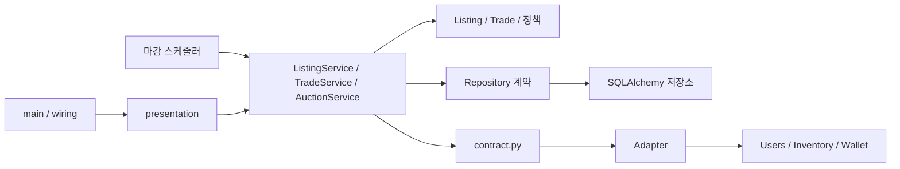

# Auction — 경매장 매물·입찰·정산

**담당: [@bsis09872-ux](https://github.com/bsis09872-ux)** · 경매 화면: [@eeseuju](https://github.com/eeseuju)

아이템 매물 등록, 입찰, 마감 정산과 거래 기록을 담당합니다. 같은 아이템 종류는 한 번에 1개만 6분간 공개하고, 나머지는 대기열에서 등록 순서대로 공개합니다.

[프로젝트 README](../../README.md) | [Inventory 문서](../inventory/README.md) | [Users 문서](../users/README.md) | [관리자 경매 연결](../../docs/project-structure.md#관리자-경매-조회) | [경매 화면](../../docs/project-structure.md#인벤토리경매-화면)

## 제공 기능

| 구분 | 동작 |
| --- | --- |
| 매물 등록 | 카탈로그 시작가로 등록. 같은 종류가 공개 중이면 대기(QUEUED), 아니면 즉시 공개(BIDDING) |
| 매물 조회 | 공개 중 목록(최신순 20개), 상세(현재가·남은 시간) |
| 입찰 | 현재가보다 높은 금액. 자기 매물·연속 최고 입찰 금지, Wallet에 자금 확인 요청 |
| 등록 취소 | 판매자가 공개 전(QUEUED) 본인 매물 취소, 아이템 예약 해제 |
| 마감 정산 | 5초마다 마감 매물 처리. 낙찰 시 아이템·재화 이전과 거래 기록, 입찰자 없으면 유찰 |
| 다음 매물 공개 | 마감·취소 직후 같은 종류의 가장 오래된 대기 매물 공개 |
| 연속 낙찰 제한 | 30분 내 3회 낙찰 시 15분간 새 입찰 금지. 상태 조회 제공 |
| 거래 내역 | 내 낙찰·판매 내역 (체결 당시 이름·가격 스냅샷) |
| 관리자 | 매물·거래 필터 조회, QUEUED·BIDDING 매물 강제 취소 |

낙찰자가 탈퇴해 정산할 수 없으면 rollback 후 새 트랜잭션에서 자동 유찰합니다. 잔액·인벤토리 불일치는 데이터를 보호하기 위해 유찰하지 않고 다음 주기에 재시도합니다. 재판매 제한(낙찰 후 30분)은 Inventory가 판단합니다.

## 구조와 책임



| 위치 | 역할 |
| --- | --- |
| [`domain/`](domain/README.md) | 매물 상태·입찰 규칙, 거래 기록, 연속 낙찰 제한 계산, 경매 예외 |
| [`application/`](application/README.md) | 등록·입찰·취소·마감 정산 순서와 트랜잭션, 다른 도메인 계약 |
| [`infrastructure/`](infrastructure/README.md) | DB 모델·저장소, 행 잠금·종류 잠금, 다른 도메인 Adapter와 예외 변환 |
| [`presentation/`](presentation/README.md) | API·관리자·경매 화면 라우터, 입력 범위 검사, 마감 스케줄러 |
| [`wiring.py`](wiring.py) | 같은 세션으로 저장소·Adapter·서비스 조립, FastAPI 의존성 연결 |

Auction은 다른 도메인의 wiring만 import합니다. 다른 도메인의 모델·저장소는 직접 쓰지 않고, 다른 도메인 ID는 FK 없이 값으로만 저장합니다. 인증 의존성은 main.py가 넘겨 줍니다.

## HTTP API

| 메서드 | 경로 | 용도 |
| --- | --- | --- |
| GET | `/v1/listings` | 공개 중 매물 목록. `page` |
| GET | `/v1/listings/{listing_id}` | 매물 상세 |
| POST | `/v1/listings` | 매물 등록. JSON `inventory_item_id` |
| POST | `/v1/listings/{listing_id}/bids` | 입찰. JSON `amount` |
| DELETE | `/v1/listings/{listing_id}` | 대기 매물 등록 취소 (판매자) |
| GET | `/v1/trades/me/won` | 내 낙찰 내역 |
| GET | `/v1/trades/me/sold` | 내 판매 내역 |
| GET | `/v1/trades/me/bid-limit` | 내 입찰 제한 상태 |
| GET | `/v1/listings/management` | 관리자 매물 조회. ID·상태 필터 |
| GET | `/v1/trades/management` | 관리자 거래 조회. ID 필터 |
| POST | `/v1/listings/management/{listing_id}/cancel` | 관리자 강제 취소 (Bearer) |
| POST | `/admin/listings/{listing_id}/cancel` | 관리자 강제 취소 (웹 쿠키) |

`/v1` API는 Bearer 인증, `/admin` 웹 경로는 HttpOnly 쿠키 인증과 Origin 검사를 사용합니다. 사용자 ID는 인증에서만 받고 요청 본문의 ID를 신뢰하지 않습니다. ID가 BIGINT 범위(1 ~ 2⁶³−1)를 벗어나면 422, 시각은 UTC ISO 8601로 반환합니다.

| 오류 code | HTTP | 상황 |
| --- | --- | --- |
| `AUCTION_ENDED` | 409 | 마감 후 입찰 |
| `BID_NOT_HIGHER` | 409 | 현재가 이하 입찰 |
| `BID_BANNED` | 403 | 연속 낙찰 제한 중 입찰 |

관리자 화면(`/admin/auctions`, `/admin/auction-trades`)과 경매 화면(`/auctions` 등)은 [공통 문서](../../docs/project-structure.md#인벤토리경매-화면)를 참고하세요.

## 다른 도메인에서 사용하기

```python
from auction.wiring import build_auction_scheduler, build_held_amount_reader

scheduler = build_auction_scheduler()      # main lifespan에서 start / stop
reader = build_held_amount_reader(session) # Wallet이 입찰에 묶인 금액을 조회
```

| 공개 기능 | 사용처와 조건 |
| --- | --- |
| `wire_auction_dependencies(app, current_user_id)` | main.py. 서비스와 인증 의존성을 실제 구현으로 연결 |
| `build_auction_scheduler()` | main.py lifespan. `create_all` 뒤 시작, `engine.dispose` 전에 종료 |
| `build_held_amount_reader(session)` | Wallet. 사용자가 최고 입찰자인 진행 매물의 금액 합계 |
| `build_admin_auction_queries(session)` | composition.py. 관리자 화면 조회 |

**경매가 다른 도메인에 요청하는 기능** ([`application/contract.py`](application/contract.py))

| 대상 | 기능 |
| --- | --- |
| Users | 제한 상태 조회, ID 오름차순 잠금 조회, 낙찰 제한 저장, 표시 이름, 관리자 여부 |
| Inventory | 아이템 예약·해제·이전·요약 조회 |
| Wallet | 입찰 자금 확인, 낙찰 재화 이전 |

모든 쓰기 작업은 같은 세션에서 **매물 → 아이템 종류 → 다음 대기 매물 → 아이템 → 사용자 → 지갑** 순서로 잠급니다. Adapter와 저장소는 flush까지만 하고 commit은 경매 서비스가 합니다. 실패하면 요청의 `get_db`가, 스케줄러에서는 서비스가 rollback합니다.

## 실행과 검증

실행 방법은 [프로젝트 README](../../README.md#개발-서버-실행)를 따릅니다. 마감 스케줄러는 서버와 함께 시작·종료되며 별도 실행이 필요 없습니다. 기존 DB에는 처음 한 번 관리자 취소 컬럼을 추가합니다.

```bash
uv run --frozen python scripts/migrate-auction-admin-cancel.py
uv run --frozen --with httpx --with playwright python scripts/verify-admin-auctions.py
```

관리자 조회·강제 취소는 팀 통합 검증 스크립트로 확인했습니다. 마감 정산은 개인 테스트(단위 10개, 실제 PostgreSQL 통합 7개)로 정상 낙찰, 유찰, 자동 유찰, 잔액 부족 rollback, 동시 마감, 종류 잠금 경합을 검증했습니다. 이 테스트는 gitignore 대상인 `tests/`에 있어 저장소에는 포함되지 않습니다.

## 기여 기록

| 커밋된 작업 | 기여자 | 대표 커밋 |
| --- | --- | --- |
| 아이템 종류 advisory lock, 낙찰 정산과 다음 매물 공개 | [@bsis09872-ux](https://github.com/bsis09872-ux) | `08921c2`, `10d118b` |
| 마감 스케줄러와 앱 수명 연결 | [@bsis09872-ux](https://github.com/bsis09872-ux) | `11a2698`, `639a70b` |
| 관리자 강제 취소와 인벤토리 불일치 예외 | [@bsis09872-ux](https://github.com/bsis09872-ux) | `50ba0e2`, `ca10f49`, `1846cd8` |
| 관리자 웹 쿠키 인증 취소 API | [@bsis09872-ux](https://github.com/bsis09872-ux) | `2ab47a8` |
| API 입력 BIGINT 범위 검증 | [@bsis09872-ux](https://github.com/bsis09872-ux) | `bc09e51` |
| 낙찰자 이용 불가 시 자동 유찰 | [@bsis09872-ux](https://github.com/bsis09872-ux) | `9d2a773`, `1a3f1ba` |
| 경매장 목록·상세·등록·내 거래 화면과 실시간 반영 | [@eeseuju](https://github.com/eeseuju) | `fa519dd`, `f9aa729`, `e227a22` |
| 관리자 라우터 조립 분리, 취소 API 범위·캐시 검증 | [@Cocode96](https://github.com/Cocode96) | `877ba38`, `76ca092` |
| 경매 지갑 조립에 예약금 조회기 주입 | [@ilmae-322](https://github.com/ilmae-322) | `b17b836` |

대표 커밋은 `main`의 실제 작성 이력을 기준으로 확인했습니다.
