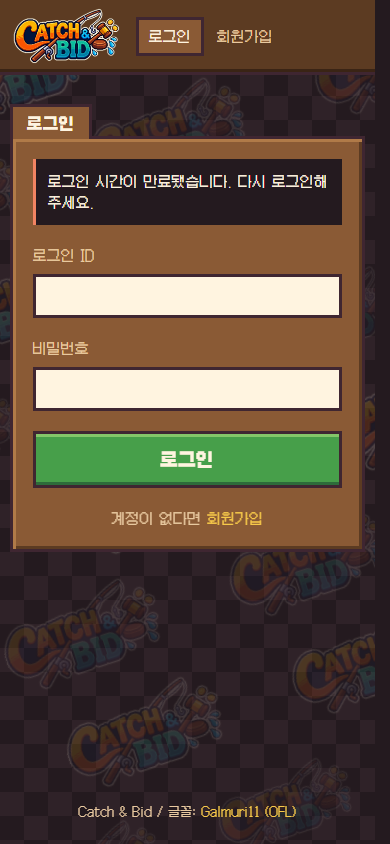
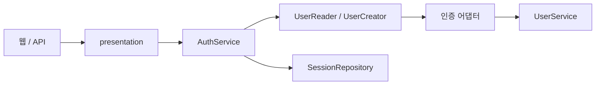

# Auth — 인증과 로그인 세션

**담당: [@Cocode96](https://github.com/Cocode96)**

회원가입과 로그인, JWT 발급, 로그인 세션의 갱신과 폐기를 담당합니다. 웹 화면에는 HttpOnly 쿠키 인증을, 외부 API에는 Bearer 인증을 제공합니다.

[프로젝트 README](../../README.md) | [Users 문서](../users/README.md) | [관리자 연결 구조](../../docs/project-structure.md#관리자-화면과-도메인-연결)

## 제공 기능

| 기능 | 현재 동작 |
| --- | --- |
| 회원가입 | 비밀번호를 해싱하고 Users의 회원 생성 기능을 호출 |
| 로그인 | 계정을 확인하고 access/refresh token과 로그인 세션 생성 |
| 요청 인증 | JWT 서명/만료, DB 세션의 폐기/만료와 현재 회원 상태 검사 |
| 세션 갱신 | refresh token 회전. 이미 사용한 refresh token이 재사용되면 해당 세션 폐기 |
| 로그아웃 | 현재 세션 폐기. 다른 로그인 세션은 유지 |
| 웹 인증 | HttpOnly 쿠키, 관리자 권한과 변경 요청의 Origin 검사 |

<details>
<summary>로그인 화면 보기</summary>



</details>

## 요청 흐름과 구조



| 위치 | 역할 |
| --- | --- |
| [`presentation/router.py`](presentation/router.py) | Bearer API의 가입/로그인/갱신/로그아웃 |
| [`presentation/web_router.py`](presentation/web_router.py) | 로그인/가입 화면, 쿠키 발급과 웹 세션 처리 |
| [`presentation/dependencies.py`](presentation/dependencies.py) | API 요청의 인증 서비스와 현재 사용자 주입 |
| [`presentation/web_dependencies.py`](presentation/web_dependencies.py) | 쿠키 인증, 관리자 검사, Origin과 쿠키 설정 |
| [`application/service.py`](application/service.py) | 인증 절차와 트랜잭션 확정 |
| [`application/contracts.py`](application/contracts.py) / [`dto.py`](application/dto.py) | 해시/토큰/회원/세션 계약과 전달 데이터 |
| [`infrastructure/`](infrastructure/) | 비밀번호 해시, JWT, 세션 저장소와 Users 연결 어댑터 |
| [`wiring.py`](wiring.py) | 같은 요청 DB 세션으로 인증 부품 조립 |

Auth의 application/domain은 FastAPI와 SQLAlchemy를 import하지 않습니다. Users 연결은 인프라 어댑터에서 처리합니다. 관리자 경매나 아이템 서비스 조립은 Auth에 두지 않습니다.

## HTTP API

| 메서드 | 경로 | 입력 / 결과 |
| --- | --- | --- |
| POST | `/v1/auth/register` | JSON `login_id`, `display_name`, `password` → 회원 생성 |
| POST | `/v1/auth/token` | 폼 `username`, `password` → 토큰 쌍. `username`은 로그인 ID |
| POST | `/v1/auth/refresh` | JSON `refresh_token` → 새 토큰 쌍 |
| POST | `/v1/auth/logout` | Bearer 토큰 → 현재 로그인 세션 폐기 |
| POST | `/v1/auth/refresh/logout` | JSON `refresh_token` → access token 만료 후 세션 폐기 |

웹은 `GET/POST /register`, `GET/POST /login`, `GET /session`, `POST /session/refresh`, `POST /logout`을 사용합니다. 웹 변경 요청은 `WEB_ORIGIN`과 일치하는 Origin이 필요합니다. 토큰은 JavaScript가 읽을 수 없는 HttpOnly 쿠키로 전달합니다. 쿠키는 SameSite=Lax이며 HTTPS에서는 Secure를 적용합니다.

## 다른 도메인에 연결하기

라우터는 인증 함수 자체를 인자로 받고, 앱에서 실제 구현을 주입합니다.

```python
from auth.presentation.dependencies import get_current_user_id
from auth.presentation.web_dependencies import get_current_web_admin_id
from composition import get_member_admin_service
from users.presentation.router import create_user_router
from users.presentation.admin_router import create_member_admin_router

app.include_router(create_user_router(get_current_user_id), prefix="/v1")
app.include_router(
    create_member_admin_router(get_current_web_admin_id, get_member_admin_service)
)
```

위 코드는 [`main.py`](../main.py)의 등록 방식을 발췌한 것입니다. `get_current_web_admin_id`는 인증과 현재 관리자 권한을 확인한 ID를 반환하고, 변경 요청에서는 Origin도 검사합니다. 요청 본문의 회원 ID로 인증된 사용자 ID를 대신하지 않습니다.

[`composition.py`](../composition.py)는 `get_password_hasher()`와 `build_session_revoker(session)`를 Users의 관리자 서비스에 주입합니다. 이 연결 덕분에 Users가 Auth를 import하지 않고도 비밀번호 해싱과 로그인 세션 폐기를 사용할 수 있습니다.

## 실행 설정과 수명

서버 실행은 [프로젝트 README](../../README.md#개발-서버-실행)를 따릅니다. 저장소 루트의 [.env.example](../../.env.example)을 참고해 `.env.local`을 준비합니다.

| 설정 | 기본값 / 조건 |
| --- | --- |
| `DATABASE_URL` | PostgreSQL 비동기 연결 주소. 필수 |
| `JWT_SECRET_KEY` | 32바이트 이상의 무작위 비밀키. 필수 |
| `JWT_TTL_SECONDS` | `1800`초, access token 수명 |
| `REFRESH_TTL_SECONDS` | `1800`초, 로그인 세션 수명 |
| `WEB_ORIGIN` | `http://127.0.0.1:8000`. 실제 접속 주소와 일치 |

로그인 세션 만료 시각은 최초 로그인 기준이며 갱신해도 연장하지 않습니다. 갱신 토큰 원문은 DB에 저장하지 않고 해시를 저장합니다. 인증 절차는 같은 요청 세션을 공유하고, 성공한 변경을 commit합니다. 예외 시 요청 경계의 `get_db`가 rollback합니다. 재사용된 refresh token에 대한 세션 폐기는 오류 응답 전에 commit합니다.

## 검증과 기여 기록

저장소 루트에서 실행합니다.

```bash
uv run --frozen python scripts/verify-domain-boundaries.py
uv run --frozen --with httpx --with playwright python scripts/verify-admin-auctions.py
```

도메인 참조 검사와 실제 로그인, 쿠키/Bearer 권한, Origin, 회원 정지 후 세션 폐기 검증을 통과했습니다. 통합 테스트는 임시 PostgreSQL DB 생성 권한과 Chromium이 필요합니다. 브라우저 설치와 상세 검증 조건은 [공통 검증 문서](../../docs/project-structure.md#관리자-조회와-취소-검증)를 참고하세요.

| 커밋된 작업 | 기여자 | 대표 커밋 |
| --- | --- | --- |
| 인증 API와 로그인 세션 수명 관리 | [@Cocode96](https://github.com/Cocode96) | `2c834ec` |
| 로그아웃 차단을 로그인 세션 기준으로 통일 | [@Cocode96](https://github.com/Cocode96) | `57801f4` |
| 기본 세션 수명 30분 적용 | [@Cocode96](https://github.com/Cocode96) | `0d6c61a` |
| 관리자 조립 분리와 Auth 순환 참조 제거 | [@Cocode96](https://github.com/Cocode96) | `877ba38` |

대표 커밋은 이 문서가 포함된 브랜치의 실제 작성 이력을 기준으로 확인했습니다.
