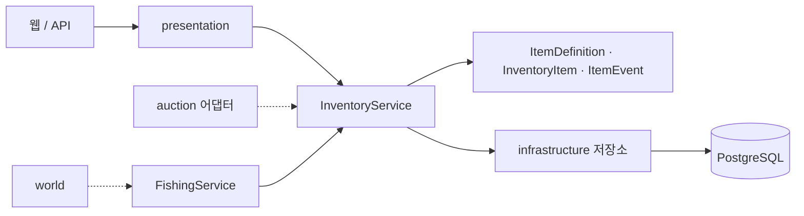

# Inventory — 아이템과 소유 이력

아이템 카탈로그와 사용자가 가진 아이템, 소유가 바뀐 이력을 담당합니다.  
경매 도메인에는 판매 예약, 해제, 소유권 이전 기능을 제공하고, 낚시 보상을 추첨해 지급합니다.

## 제공 기능

| 기능            | 현재 동작                                                                                                           |
| --------------- | ------------------------------------------------------------------------------------------------------------------- |
| 아이템 카탈로그 | 관리자가 만들고 수정, 삭제. 이름·분류·희귀도·시작가·낚시 가중치를 가지며 `name`과 `category`는 만든 뒤 바꿀 수 없음 |
| 내 가방         | 내 아이템 목록(분류·희귀도·상태 필터, 정렬, 페이지)과 상세. 남의 아이템은 404                                       |
| 소유 이력       | 지급, 예약, 해제, 이전이 일어날 때마다 한 줄 기록. 수정과 삭제 없음, 관리자가 조회                                  |
| 경매 연동       | 예약(`OWNED → LISTED`), 해제, 낙찰자에게 소유권 이전                                                                |
| 낚시 보상       | 낚시 가능한 카탈로그에서 가중치로 추첨해 `REWARD` 출처로 지급. 쿨다운은 사용자별 10초(DB 공유)                      |
| 화면            | 내 가방(칸 격자), 아이템 상세, 도감                                                                                 |

## 요청 흐름과 구조



| 위치                                                                                                         | 역할                                               |
| ------------------------------------------------------------------------------------------------------------ | -------------------------------------------------- |
| [`presentation/router.py`](presentation/router.py)                                                           | 조회와 카탈로그 관리 API                           |
| [`presentation/web_router.py`](presentation/web_router.py) / [`web_filters.py`](presentation/web_filters.py) | 가방, 상세, 도감 화면과 필터 주소                  |
| [`presentation/admin_router.py`](presentation/admin_router.py)                                               | 관리자 카탈로그, 이력, 이미지 화면                 |
| [`presentation/dependencies.py`](presentation/dependencies.py)                                               | 현재 사용자, 관리자 확인, 서비스 주입              |
| [`application/service.py`](application/service.py)                                                           | 조회, 지급, 관리, 경매 연동 메서드                 |
| [`application/fishing_service.py`](application/fishing_service.py)                                           | 쿨다운, 추첨, 지급                                 |
| [`application/contracts.py`](application/contracts.py)                                                       | 필요한 기능의 모양(Protocol)                       |
| [`domain/`](domain/)                                                                                         | 아이템 규칙과 상태 전이(순수 파이썬)               |
| [`infrastructure/`](infrastructure/)                                                                         | 모델, 저장소, 쿨다운, 캐시, 회원·인증 어댑터, 시드 |
| [`wiring.py`](wiring.py)                                                                                     | 같은 요청 DB 세션으로 부품 조립                    |

domain은 FastAPI와 SQLAlchemy를 import하지 않고, 다른 도메인의 infrastructure도 import하지 않습니다.  
업무 판정은 domain이 하고, 라우터는 입력 검증과 응답 변환만 합니다.  
commit은 서비스가 하며 오류 시 rollback은 공통 `get_db`가 합니다.

## 상태와 규칙

```text
지급 ──▶ OWNED ──예약──▶ LISTED ──낙찰(소유권 이전)──▶ OWNED(구매자)
           ▲                │
           └──예약 해제─────┘  (유찰·취소)
```

- 소유자가 바뀌는 경로는 `transfer_to` 하나뿐입니다.
- 이미 `LISTED`인 아이템은 다시 예약할 수 없습니다(409). 거래로 받은 아이템은 30분 동안 재판매할 수 없습니다.
- 예약, 해제, 이전은 아이템 행을 `SELECT … FOR UPDATE`로 잠그고 잠근 뒤의 최신 상태로 판정합니다.
- 시작가는 `BIGINT`, 가중치는 `INTEGER` 범위를 넘으면 도메인이 거절합니다.

| 막으려는 것      | 방법                                                                                   |
| ---------------- | -------------------------------------------------------------------------------------- |
| 아이템 위조      | 생성은 서버 내부 `grant_item`뿐. 속성은 항상 서버 카탈로그에서 읽고 요청으로 받지 않음 |
| 남의 아이템 접근 | 소유자는 요청 값이 아니라 로그인 토큰에서 얻음                                         |
| 이중 판매·복제   | 소유자는 한 명, 예약은 한 번만, 동시 요청은 행 잠금으로 하나씩 처리                    |
| 정산 실패        | 예약·해제·이전은 commit하지 않고 호출한 쪽 트랜잭션에 묶여 함께 rollback               |
| 마지막 방어선    | DB `CHECK`(분류·희귀도·상태·출처·가격·가중치), 외래키, `code` 유일 제약                |

## HTTP API

경로의 접두어는 `/v1`이고 모두 로그인이 필요합니다.

| 메서드              | 경로                                    | 권한   | 설명                      |
| ------------------- | --------------------------------------- | ------ | ------------------------- |
| GET                 | `/inventory`                            | 로그인 | 내 아이템 목록            |
| GET                 | `/inventory/{item_id}`                  | 본인   | 내 아이템 상세            |
| GET                 | `/item-catalogs`, `/item-catalogs/{id}` | 로그인 | 카탈로그 목록, 상세       |
| POST, PATCH, DELETE | `/item-catalogs`, `/item-catalogs/{id}` | 관리자 | 카탈로그 생성, 수정, 삭제 |
| GET                 | `/inventory/{item_id}/events`           | 관리자 | 아이템 이력               |

낚시 API(`POST /v1/fishing-results`)와 낚시터 화면은 [`client`](../client/README.md)가 조립합니다.  
이 도메인은 낚시 추첨과 지급 서비스를 제공합니다.

화면은 `/inventory`(내 가방), `/inventory/{item_id}`(상세), `/item-catalogs`(도감)이고 쿠키 로그인을 씁니다.  
로그인 확인과 지갑 박스 읽기 함수는 [`main.py`](../main.py)가 넘겨줍니다.  
오류 응답은 `{"detail": {"code", "message"}}` 모양입니다.

## 다른 도메인에 연결하기

`InventoryService`가 Auction에 제공하는 기능입니다. Auction은 자기 계약(`InventoryGateway`)과 어댑터로 호출합니다.

| 메서드                                                                         | commit | 설명                                                                  |
| ------------------------------------------------------------------------------ | ------ | --------------------------------------------------------------------- |
| `reserve_for_listing(item_id, by_owner_id, now, listing_id)`                   | X      | `OWNED → LISTED`                                                      |
| `release_from_listing(item_id, by_owner_id, now, listing_id)`                  | X      | `LISTED → OWNED`(판매자 그대로)                                       |
| `transfer_to(item_id, new_owner_id, now, listing_id, trade_id, from_owner_id)` | X      | `LISTED → OWNED`(낙찰자). `from_owner_id`가 현재 소유자와 다르면 거절 |
| `grant_item(definition_id, owner_id, origin, now, actor_id)`                   | O      | 아이템 새로 지급                                                      |

`commit`을 하지 않는 메서드는 호출한 쪽이 `commit`과 `rollback`을 합니다.  
낚시 보상은 World가 `FishingService`를 직접 호출해 지급하고 최종 commit도 World가 합니다. (낚시터를 외부 작업본에서 통합한 예외)  
Inventory가 다른 도메인에 요청하는 것은 `UserLookup`(회원 확인)과 `CurrentUserProvider`(토큰으로 요청자 확인) 둘뿐입니다.

## 설정과 시드

| 설정                   | 기본값 / 조건                                                            |
| ---------------------- | ------------------------------------------------------------------------ |
| `DEMO_FISHING_ENABLED` | 켜짐. `false`, `0`, `no`, `off`로 두면 낚시 API와 보상 지급이 꺼짐       |
| `CACHE_TTL_SECONDS`    | `15`. 카탈로그 조회 캐시 수명(초). 0 이하나 숫자가 아니면 시작할 때 오류 |

앱을 한 번 켜서 테이블이 만들어진 뒤 저장소 루트에서 시드를 실행합니다. 낚시와 가방 화면을 확인하려면 필요합니다.

```bash
PYTHONPATH=src uv run python -m inventory.infrastructure.seed
```

카탈로그 13개와 시연용 아이템 24개를 넣습니다. 시연 소유자는 사용자 1, 2, 3이고, 여러 번 실행해도 안전합니다.

## 한계

- 카탈로그 캐시는 프로세스 메모리라 서버를 여러 개 띄우면 TTL 동안 값이 어긋날 수 있습니다.
- 회원 탈퇴 시 아이템 처리는 보류했습니다.
- 잠금 대기 시간 제한(`lock_timeout`)과 동시 요청 부하 테스트는 하지 않았습니다.
- 같은 `code`로 동시에 생성하면 DB 제약이 막지만 응답이 500일 수 있습니다.
