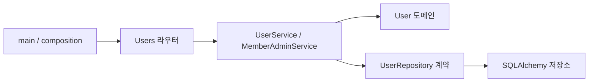

# Users — 회원 정보와 상태 관리

**담당: [@Cocode96](https://github.com/Cocode96)**

회원 정보, 역할, 로그인 정지와 경매 입찰 제한을 관리합니다. Auth에는 회원 생성/조회 기능을, 다른 도메인에는 필요한 회원 요약과 관리자 여부 조회 기능을 제공합니다.

[프로젝트 README](../../README.md) | [Auth 문서](../auth/README.md) | [관리자 연결 구조](../../docs/project-structure.md#관리자-화면과-도메인-연결)

## 제공 기능

| 구분 | 동작 |
| --- | --- |
| 회원 생성 | 로그인 ID 중복 확인, 해시된 비밀번호 저장, 기본 역할 `USER` |
| 회원 조회 | 내 정보, 관리자 회원 검색/상세, 도메인 연동용 회원 요약 |
| 관리자 여부 | 현재 회원이 로그인 가능한 `ADMIN`인지 확인 |
| 권한 관리 | `USER`/`ADMIN` 변경, 자기 강등과 마지막 로그인 가능 관리자 보호 |
| 로그인 정지 | 회원 상태 변경과 기존 로그인 세션 폐기를 같은 트랜잭션으로 처리 |
| 입찰 제한 | 경매의 자동 제한과 관리자의 수동 제한을 분리해 보관 |
| 경매 연동 | 회원 ID 순서의 잠금 조회, 구매 횟수와 자동 제한 저장 |

로그인 정지를 해제해도 폐기된 세션은 복구되지 않습니다. 사용자는 다시 로그인해야 합니다. 회원 생성 시 지갑을 별도로 만들지 않으며 Wallet의 기존 지연 생성 정책을 사용합니다.

## 구조와 책임



| 위치 | 역할 |
| --- | --- |
| [`presentation/router.py`](presentation/router.py) / [`web_router.py`](presentation/web_router.py) | 내 정보 API와 웹 화면 |
| [`presentation/admin_router.py`](presentation/admin_router.py) | 관리자 회원 목록/상세와 변경 요청 |
| [`application/service.py`](application/service.py) | 회원 조회/생성과 외부 도메인 연동 |
| [`application/admin_service.py`](application/admin_service.py) | 관리자 권한 검사, 잠금과 회원 변경 확정 |
| [`application/contracts.py`](application/contracts.py) / [`admin_contracts.py`](application/admin_contracts.py) | 회원 조회, 해시, 트랜잭션과 세션 폐기 계약 |
| [`domain/user.py`](domain/user.py) / [`repository.py`](domain/repository.py) | 회원 규칙과 저장소 계약 |
| [`infrastructure/repositories.py`](infrastructure/repositories.py) | DB 조회, 행 잠금과 저장 |
| [`wiring.py`](wiring.py) | UserService와 MemberAdminService 조립 |

Users는 Auth, Auction, Inventory와 Wallet을 import하지 않습니다. 인증 구현은 라우터 생성 시 주입하고, 관리자 서비스의 해시/세션 폐기 부품은 앱 조립부에서 계약에 맞춰 전달합니다.

## HTTP API와 화면

| 메서드 | 경로 | 용도 |
| --- | --- | --- |
| GET | `/v1/users/me` | Bearer 인증으로 내 정보 조회 |
| GET | `/me` | 쿠키 인증으로 내 정보 화면 |
| GET | `/admin/members` | 관리자 회원 검색. `q`, `role`, `page` 지원 |
| GET | `/admin/members/new` | 회원 생성 화면 |
| GET | `/admin/members/{member_id}` | 회원 상세와 제어 화면 |
| POST | `/admin/member-accounts` | 일반 회원 계정 생성 |
| PATCH | `/admin/member-accounts/{member_id}/role` | 역할 변경 |
| PATCH | `/admin/member-accounts/{member_id}/login-suspension` | 로그인 정지/해제 |
| PATCH | `/admin/member-accounts/{member_id}/bid-restriction` | 수동 입찰 제한 설정/해제 |

관리자 웹 API는 HttpOnly 쿠키를 사용하며 변경 요청의 Origin을 검사합니다. 회원 번호는 응답에서 문자열, 시각은 UTC ISO 8601로 전달합니다.

| 변경 요청 | JSON 본문 |
| --- | --- |
| 회원 생성 | `{"login_id":"new_member","display_name":"새 회원","password":"사용자가 정한 비밀번호"}` |
| 역할 변경 | `{"role":"ADMIN"}` 또는 `{"role":"USER"}` |
| 로그인 정지/해제 | `{"suspended":true}` 또는 `{"suspended":false}` |
| 입찰 제한 | `{"until":"2026-12-01T00:00:00Z"}`. 해제는 `{"until":null}` |

`/admin/members/{member_id}/inventory`는 Inventory의 관리자 라우터가 제공합니다. 회원 화면에서 연결하지만 아이템 조회 책임은 Inventory에 있습니다. 전체 관리자 메뉴와 화면 전환 방식은 [공통 문서](../../docs/project-structure.md#관리자-화면과-도메인-연결)에 정리했습니다.

## 다른 도메인에서 사용하기

```python
from users.wiring import build_user_service, build_admin_role_checker

users = build_user_service(session)
summary = await users.get_user_summary(user_id)

checker = build_admin_role_checker(session)
allowed = await checker.is_admin(user_id)
```

예제의 `session`은 호출자가 관리하는 AsyncSession이고 `user_id`는 인증을 마친 회원 ID입니다. 관리자 여부 조회 자체가 토큰을 검증하지는 않습니다.

| 공개 기능 | 호출 조건과 결과 |
| --- | --- |
| `get_user_summary(user_id)` | 회원 요약 반환. 탈퇴/제한 상태는 호출자가 확인 |
| `is_admin(user_id)` | 없는 회원, 일반 회원, 탈퇴/로그인 정지 회원은 `False` |
| `get_for_update_many(user_ids)` | 회원 ID 순서로 잠그고 요약 사전 반환. 없는 ID는 생략 |
| `update_auction_limit(user_id, purchase_count, blocked_until)` | 구매 횟수와 자동 제한 저장. commit하지 않음 |
| `create_user(login_id, display_name, password_hash)` | 이미 해싱된 비밀번호를 받음. 최종 commit은 호출자 담당 |

여러 회원을 변경할 때는 먼저 필요한 회원을 함께 잠급니다. 경매의 매물 → 아이템 → 회원 → 지갑 잠금 순서와 같은 세션을 유지해야 합니다. 관리자 회원 변경은 `MemberAdminService`가 commit하고, 실패 시 요청의 `get_db`가 rollback합니다.

## 실행과 검증

실행 방법은 [프로젝트 README](../../README.md#개발-서버-실행), 인증 설정은 [Auth 문서](../auth/README.md#실행-설정과-수명)를 참고하세요. 회원 역할은 기본 `USER`이며 최초 관리자 계정은 자동 생성하지 않습니다.

```bash
uv run --frozen python scripts/verify-domain-boundaries.py
uv run --frozen --with httpx --with playwright python scripts/verify-admin-auctions.py
```

저장소 루트에서 실행합니다. 임시 PostgreSQL과 Chromium으로 회원 생성, 역할 변경, 입찰 제한, 로그인 정지/해제와 기존 세션 폐기, 관리자 탭 전환을 검증했습니다. 도메인 참조 검사에서는 Users의 다른 업무 도메인 import가 없음을 확인했습니다. 환경 조건은 [공통 검증 문서](../../docs/project-structure.md#관리자-조회와-취소-검증)를 참고하세요.

## 기여 기록

| 커밋된 작업 | 기여자 | 대표 커밋 |
| --- | --- | --- |
| 경매 연동용 회원 잠금 조회와 제한 상태 저장 | [@Cocode96](https://github.com/Cocode96) | `74d1da3` |
| 관리자 회원 검색/상세와 계정 생성 | [@Cocode96](https://github.com/Cocode96) | `ae68097`, `9d642b2` |
| 회원 역할 변경과 자기 강등 방지 | [@Cocode96](https://github.com/Cocode96) | `70743e5` |
| 로그인 정지와 기존 세션 폐기 | [@Cocode96](https://github.com/Cocode96) | `a96996b` |
| 수동 입찰 제한 분리와 연동 계약 | [@Cocode96](https://github.com/Cocode96) | `4a76731` |
| 다른 도메인용 관리자 여부 조회 | [@Cocode96](https://github.com/Cocode96) | `fb8d8bd` |

대표 커밋은 이 문서가 포함된 브랜치의 실제 작성 이력을 기준으로 확인했습니다.
