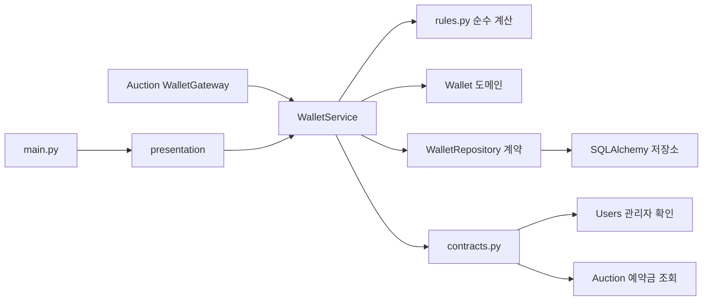

# Wallet — 지갑 잔액·입찰 자금 확인·낙찰 정산

**담당: [@ilmae-322](https://github.com/ilmae-322)**

회원의 골드 잔액을 관리합니다. 입찰할 때 돈을 바로 빼지 않고 "묶인 금액(예약금)"으로 계산하고, 낙찰 정산 때 실제로 옮깁니다. 거래 기록은 Auction이 담당하고, Wallet은 잔액만 바꿉니다.

[프로젝트 README](../../README.md) | [Auction 문서](../auction/README.md) | [Users 문서](../users/README.md) | [연동 함수 설명](application/service_interface.md)

## 제공 기능

| 구분 | 동작 |
| --- | --- |
| 지갑 생성 | 처음 필요할 때(조회·입찰·정산·충전) 만들고 초기 골드 3,000 지급. 여러 번 불려도 지급은 한 번 |
| 내 지갑 조회 | 총잔액, 묶인 금액, 사용 가능 금액(= 총잔액 − 묶인 금액) |
| 헤더 금액 | 모든 로그인 화면 헤더에 사용 가능 금액 표시 |
| 관리자 충전 | 관리자만 가능. 충전 후 잔액이 상한(1조)을 넘으면 거절 |
| 입찰 자금 확인 | Auction이 입찰 전에 호출. 입찰액이 사용 가능 금액 이하인지 확인만 하고 잔액은 그대로 |
| 낙찰 정산 | 구매자 −낙찰가, 판매자 +낙찰가. 수수료 없음 |
| 잔액 변경 로그 | DB commit이 성공한 변경만 서버 로그로 남김 |

초기 골드(3,000)와 잔액 상한(1조)은 초안 값이며 [`domain/rules.py`](domain/rules.py)의 상수만 바꾸면 됩니다. 거래 내역 조회(WALL-04, 05)는 Auction의 `/v1/trades/me/won`, `/v1/trades/me/sold`가 담당합니다.

## 예약금(hold) 방식

```
입찰    → 잔액 그대로, 그 매물의 최고 입찰액만큼 사용 가능 금액이 줄어듦
밀려남  → 잔액 그대로, 묶인 금액이 풀림 (돌려줄 돈이 없음)
낙찰    → 구매자 잔액 −낙찰가, 판매자 잔액 +낙찰가
유찰    → Wallet을 호출하지 않음
```

- 묶인 금액은 따로 저장하지 않습니다. 내가 최고 입찰자인 진행 중 매물의 입찰액 합계를 Auction이 계산해 줍니다(`HeldAmountReader`).
- 그래서 입찰 취소·밀려남·유찰 때 환불 처리가 없고, 잔액과 예약금이 서로 어긋날 일이 적습니다.
- `wallets` 테이블에는 총잔액(`balance`)과 변경 시각만 있습니다. `balance >= 0` 제약이 있습니다.

## 구조와 책임



| 위치 | 역할 |
| --- | --- |
| [`domain/wallet.py`](domain/wallet.py) | 잔액 증가·감소, 잔액 부족 예외 |
| [`domain/rules.py`](domain/rules.py) | 금액 판단(사용 가능 금액, 입찰 확인, 정산 금액, 충전 상한). DB 없이 계산만 |
| [`domain/exceptions.py`](domain/exceptions.py) | 지갑 예외. HTTP 상태는 부모 분류로 공통 핸들러가 정함 |
| [`application/service.py`](application/service.py) | 조회·잠금·저장 순서. commit하지 않음 |
| [`application/contracts.py`](application/contracts.py) | 다른 도메인에 필요한 기능(관리자 여부, 예약금)의 모양 |
| [`infrastructure/repositories.py`](infrastructure/repositories.py) | `wallets` 조회, 행 잠금, 없을 때만 생성 |
| [`infrastructure/balance_recoder.py`](infrastructure/balance_recoder.py) / [`balance_log.py`](infrastructure/balance_log.py) | 잔액 변경을 모았다가 commit 후 로그, rollback 시 버림 |
| [`presentation/`](presentation/) | API·화면 라우터, 입력 범위 검사 |
| [`wiring.py`](wiring.py) | 같은 세션으로 저장소·로그·관리자 확인·예약금 조회기를 조립 |

Wallet은 다른 도메인의 wiring만 import합니다(Users의 `build_admin_role_checker`). `listings` 테이블이나 Auction 저장소는 직접 읽지 않고, 예약금 조회기는 호출하는 쪽이 넘겨 줍니다. 인증 의존성도 main.py가 넘겨 줍니다.

## HTTP API와 화면

| 메서드 | 경로 | 용도 |
| --- | --- | --- |
| GET | `/v1/wallets/me` | 내 지갑 조회 (Bearer) |
| POST | `/v1/wallets/{user_id}/charge` | 관리자 충전 (Bearer). JSON `{"amount": 1000}` |
| GET | `/wallet` | 내 지갑 화면 (쿠키) |
| GET | `/wallet/balance` | 헤더용 사용 가능 금액 (쿠키). `{"available_balance": 3000}` |

`user_id`는 응답에서 문자열, 금액은 숫자, 시각은 UTC ISO 8601입니다. 화면 응답은 `Cache-Control: no-store`입니다. 헤더 금액은 [`static/wallet-balance.js`](../static/wallet-balance.js)가 화면을 옮길 때마다 불러옵니다. 로그인 쿠키가 HttpOnly라 JS가 `/v1` API를 부를 수 없어 쿠키 인증 경로를 따로 두었습니다.

| 오류 code | HTTP | 상황 |
| --- | --- | --- |
| (검증 오류) | 422 | `user_id`가 1 ~ 2⁶³−1 밖, `amount`가 1 ~ 1조 밖 |
| `BALANCE_LIMIT_EXCEEDED` | 400 | 충전 후 잔액이 1조 초과 |
| `INSUFFICIENT_BALANCE` | 400 | 입찰액이 사용 가능 금액 초과 (Auction이 그대로 전달) |
| `INSUFFICIENT_AUTHORITY` | 403 | 관리자가 아닌 회원의 충전 |
| `WALLET_NOT_FOUND` | 404 | 없는 회원 |
| `BUYER_BALANCE_SHORT` | 500 | 정산 때 구매자 잔액 < 낙찰가. 예약 규칙이 지켜지면 생기지 않는 불일치 |

## 다른 도메인에서 사용하기

```python
from wallet.wiring import build_wallet_service

wallets = build_wallet_service(session, held_reader=build_held_amount_reader(session))
await wallets.check_bid_funds(bidder_id=..., amount=..., current_bidder_id=..., current_bid_amount=...)
await wallets.settle_sale(buyer_id=..., seller_id=..., price=...)
```

| 공개 기능 | 사용처와 조건 |
| --- | --- |
| `check_bid_funds(...)` | Auction 입찰. 매물을 잠그고 경매 규칙을 확인한 뒤 호출. 부족하면 `INSUFFICIENT_BALANCE` |
| `settle_sale(buyer_id, seller_id, price)` | Auction 마감 정산. 유찰이면 호출하지 않음 |
| `get_my_wallet(user_id)` | 지갑 화면, 가방 화면의 지갑 박스. 지갑을 잠그고 읽음 |
| `get_available_balance(user_id)` | 헤더 표시. 잠그지 않고 읽음 |

- 서비스는 commit하지 않습니다. 호출한 쪽이 commit/rollback하면 잔액 로그도 함께 확정되거나 버려집니다.
- 처음 조회면 지갑이 만들어지므로 조회만 해도 commit해야 합니다.
- 잔액을 바꾸는 작업은 지갑 행을 `FOR UPDATE`로 잠급니다. 정산은 두 지갑을 `user_id` 오름차순으로 잠가 교차 정산 데드락을 피합니다.
- 입찰 확인은 입찰자 지갑을 잠근 뒤 예약금을 읽어, 같은 회원의 동시 입찰이 함께 통과하지 못하게 합니다.
- 잔액 상한은 충전에서만 확인합니다. 정산에서 막으면 그 매물이 마감 때마다 같은 이유로 실패해 영영 정산되지 않기 때문입니다.

함수별 인자와 예외는 [`application/service_interface.md`](application/service_interface.md)에 정리했습니다.

## 실행과 검증

실행 방법은 [프로젝트 README](../../README.md#실행-방법)를 따릅니다. 별도 마이그레이션은 없습니다.

개인 테스트 66개로 확인했습니다.

- 단위: 금액 규칙, 지연 생성, 충전 권한·상한, 입찰 확인, 정산, 로그의 commit/rollback 처리
- 입력 범위: 실제 라우터로 확인
- 로컬 서버에서 스케줄러 자동 정산: 구매자 3,000 → 1,900, 판매자 3,000 → 4,100, 밀려난 입찰자 잔액 그대로

이 테스트는 gitignore 대상인 `tests/`에 있어 저장소에는 포함되지 않습니다.

## 기여 기록

| 커밋된 작업 | 기여자 | 대표 커밋 |
| --- | --- | --- |
| 지갑 도메인 모델과 조회(예약 금액·사용 가능 금액) | [@ilmae-322](https://github.com/ilmae-322) | `0a86cf9`, `aae8024` |
| 지갑 생성·입찰 자금 확인·낙찰 정산 | [@ilmae-322](https://github.com/ilmae-322) | `ae2dc3c` |
| API 인증 연결과 첫 사용 시 지갑 생성 | [@ilmae-322](https://github.com/ilmae-322) | `eef0560` |
| commit 후 잔액 로그 자동 기록, 연동 계약 정리 | [@ilmae-322](https://github.com/ilmae-322) | `baa5c01` |
| 충전·차감 잠금 조회 | [@ilmae-322](https://github.com/ilmae-322) | `50288e8` |
| 관리자 확인을 Users 기능으로 교체 | [@ilmae-322](https://github.com/ilmae-322) | `023505b` |
| 예약금 조회를 Auction 제공 기능으로 교체, 수수료 제거 | [@ilmae-322](https://github.com/ilmae-322) | `28e20a4`, `b17b836` |
| 지갑 화면과 헤더 사용 가능 금액 | [@ilmae-322](https://github.com/ilmae-322) | `d880cdc`, `357a816`, `695f50d` |
| 충전 입력 범위와 잔액 상한 | [@ilmae-322](https://github.com/ilmae-322) | `745da8a`, `a16c89a` |

대표 커밋은 `main`의 실제 작성 이력을 기준으로 확인했습니다.
